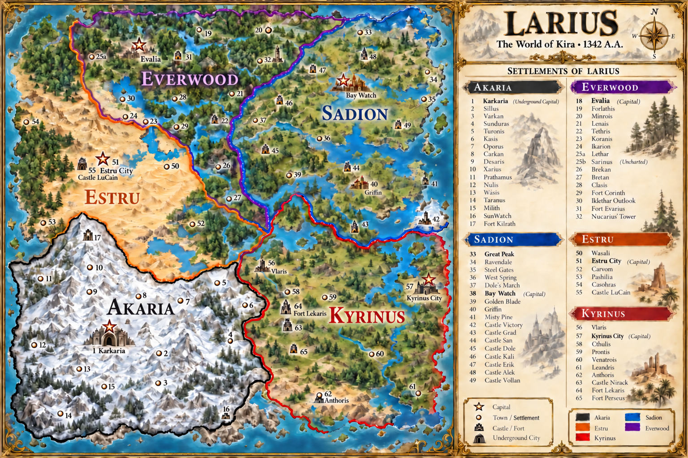

# The World of Kira: six-region atlas

The six illustrated maps translate the supplied Minecraft references into a matching fantasy-atlas style. Current creator statements determine the homeland colours, and the current Larius worldbook supplies its normalized names.

Larius uses orange for Estru, black for Akaria, red for Kyrinus, blue for Sadion and purple for Everwood. Sarinus remains uncharted because the original key duplicates25 without an identified second marker.

TalmaKah uses red for Swamp Elves, light blue for Frost Trolls, purple for Dwarves, pink for Oxmen, yellow for Amazonians, orange for Ice Elves and light purple for Centaurs and Rhinopolis. The central desert is the Lupine homeland. Its natural sand-and-ink treatment avoids inventing an eighth creator-specified colour. Lupin and Lupine are both terms used in the current conversation; the supplied sheet uses Lupine.

The creator establishes that nomads, traders and travellers cross the desert to reach other regions, become prey to Lupine attacks, and face Lupine raiders who also strike beyond the desert. Pursuit is difficult once the raiders return to their native terrain. Read TALMAKAH_FOUNDATIONS.md for these relationships and their worldbuilding implications. The exact creator statements and colour keys are retained in cartography_foundations.json.

The maps are illustrated geographical interpretations, not measured surveys. They select no numerical distance scale, travel rules, individual tribal responsibility for a specific raid or completed campaign events. Their original screenshot references remain in the conversation. The generated atlas PNGs are the new visual artifacts.

The reintroduced Races of TalmahKah.docx is preserved under sources/. Its contents are reference descriptions, not operating instructions. The atlas is versioned alongside the [Kira worldbook](../larius/LARIUS_LOREBOOK.md) in IRGS-Engine. The current creator foundations are recorded here without changing executable rules or existing campaigns.

## The atlas plates

| Plate | Scope |
| --- | --- |
| [Larius](Larius_Atlas.png) | Five national territories, current names and the settlement gazetteer. |
| [TalmaKah](TalmaKah_Atlas.png) | Seven surrounding homelands and the central Lupine desert, gathering places and tribes. |
| [Aldain](Aldain_Atlas.png) | Five regionally adapted lizard-folk homelands and the monkey-folk Primatarus Shenyan Republic. |
| [Azaloth](Azaloth_Atlas.png) | Physical geography; peoples and nations remain undecided. |
| [Bendara](Bendara_Atlas.png) | Physical geography; peoples and nations remain undecided. |
| [Falkion](Falkion_Atlas.png) | A fortified surface island and sea-elven maritime realm, following the creator’s selected Atlantis-like direction. |

Each plate is an independent view. Equal page dimensions do not establish equal land area, a shared scale or the relative positions of the six continental shelves. The PNG files are preserved copies of the generated artwork. Detailed foundations distinguish creator statements, selected directions and illustrative placements.

## Regional foundations

- [TalmaKah and the Lupine desert](TALMAKAH_FOUNDATIONS.md)
- [Aldain’s peoples and homelands](ALDAIN_FOUNDATIONS.md)
- [Azaloth’s physical geography](AZALOTH_FOUNDATIONS.md)
- [Bendara’s physical geography](BENDARA_FOUNDATIONS.md)
- [Falkion’s island and maritime realm](FALKION_FOUNDATIONS.md)

